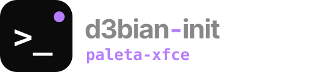
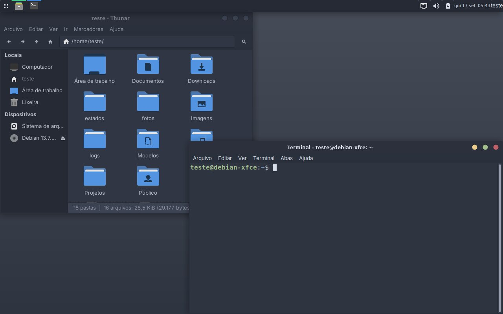
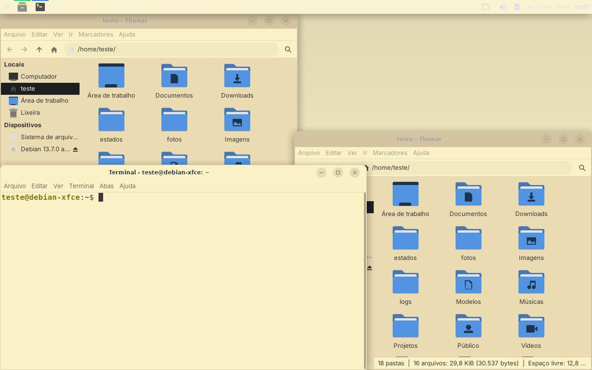
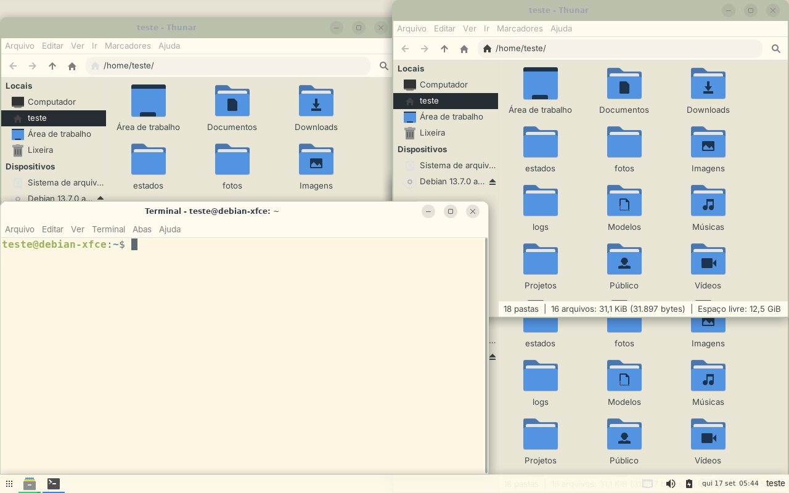
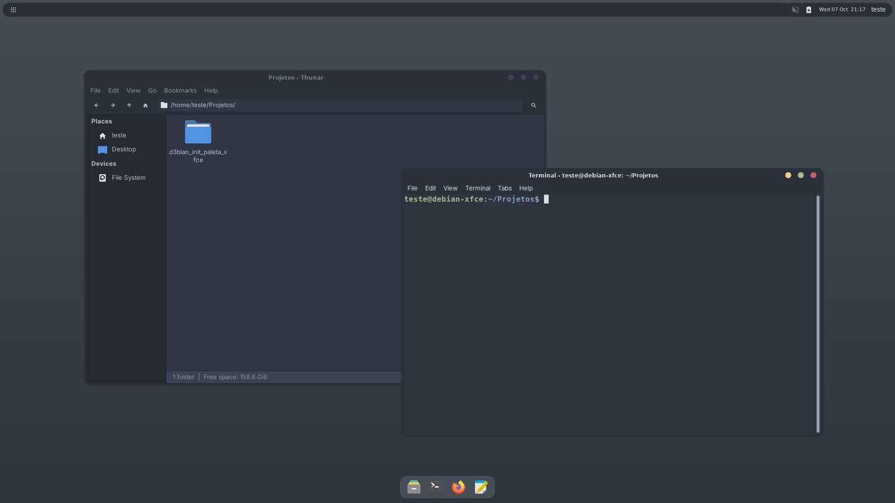
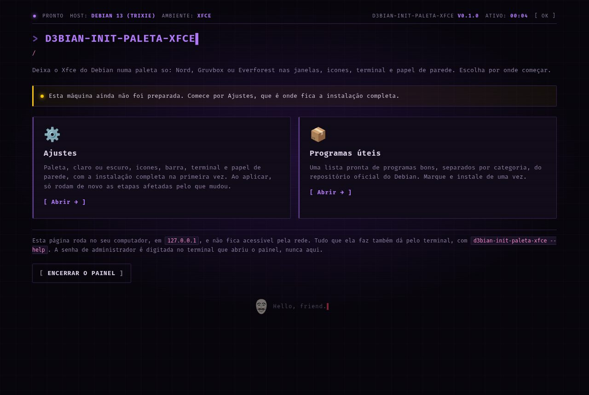
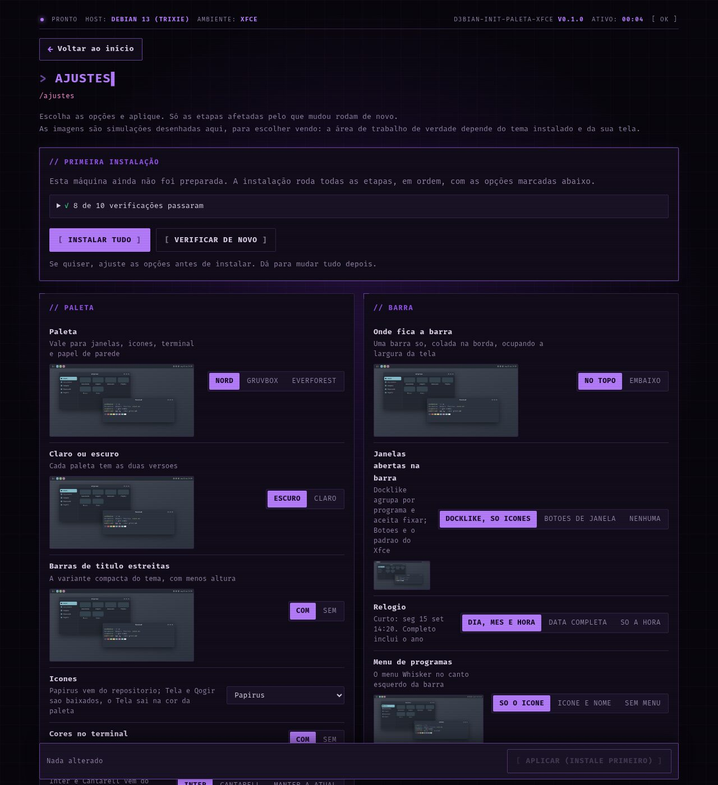
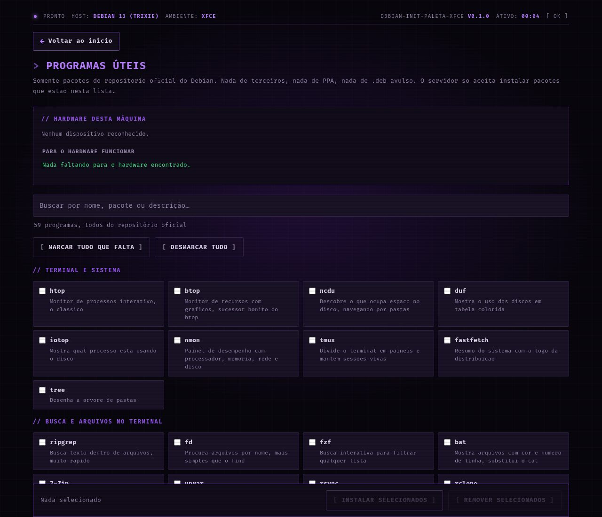
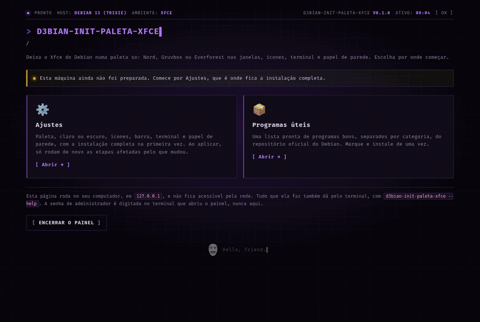

<div align="center">



**O Xfce do Debian numa paleta só: Nord, Gruvbox ou Everforest nas janelas, ícones, terminal e papel de parede.**

[](docs/desenvolvimento.md)
[](docs/desenvolvimento.md)
[](docs/uso.md#sistemas)
[](docs/uso.md#sistemas)
[](LICENSE)

</div>

> Um painel local, aberto no navegador, que deixa o Xfce do Debian **numa paleta
> só**: a escolha da paleta vale para as janelas, os ícones, o terminal e o papel
> de parede, no claro ou no escuro. Só Python da biblioteca padrão — nada de pip.

```sh
git clone https://git.saberdl.dev.br/d3bian-temas/paleta-xfce.git d3bian_init_paleta_xfce
python3 -m d3bian_init_paleta_xfce        # pede a senha uma vez e abre o painel
```

<div align="center">
  
</div>

---

## O que ele faz

- **Tema das janelas** na paleta: Nordic (Nord), Gruvbox ou Everforest, todos com
  tema de janela (xfwm4), então a barra de título acompanha a paleta
- **Ícones:** Papirus (do repositório Debian), Tela na cor da paleta, Qogir (ambos
  baixados) ou os Adwaita que já vêm no sistema
- **Terminal:** as 16 cores da paleta no xfce4-terminal, com fundo sólido
- **Barra única** no topo ou embaixo, sem dock, com docklike ou botões de janela
- **Papel de parede** desenhado na hora, liso ou em degradê, com as cores da paleta
- **Encaixe de janelas** por atalho, bordas mais largas, e nova janela e nova aba no clique direito do terminal
- **Barra em ilhas**, se quiser: barra fina solta no topo e as janelas abertas numa
  ilha embaixo, com cantos redondos (vinda do [oasis-xfce](https://git.saberdl.dev.br/d3bian-temas/oasis-xfce))
- **Efeitos com o picom**, se quiser: sombras, cantos redondos e desfoque, em modo
  leve onde não há aceleração de vídeo
- **Programas úteis**: uma lista pronta do repositório oficial do Debian, conforme o hardware
- **Voltar ao que era antes** com o diário de alterações do [modelo](https://git.saberdl.dev.br/d3bian-temas/modelo)

<!-- imagens: gerado a partir do teste num Debian 13; refazer, nao editar a mao -->
## Telas

| Com outras opções da página | Mais uma combinação de opções |
|---|---|
|  |  |

| Barra em ilhas, com o picom (`barra = ilhas`, `efeitos = desfoque`) |
|---|
|  |

| Início | Opções | Programas úteis |
|---|---|---|
|  |  |  |

<details>
<summary><b>A instalação pela página, do começo ao resultado</b></summary>



</details>
<!-- fim imagens -->

## Documentação

| | |
|---|---|
| 🚀 [Usando](docs/uso.md) | rodar, paletas, opções, o que fica onde, sistemas, voltar ao que era antes |
| 🛠️ [Desenvolvimento](docs/desenvolvimento.md) | receitas, paletas no `projeto.py`, como as imagens de exemplo são geradas |
| ⚙️ [Núcleo](docs/nucleo.md) | o motor, o servidor e as telas comuns a toda a família |

## Família d3bian-init

Todos com o mesmo motor e o mesmo jeito de usar: um painel local, só Python da biblioteca padrão, e "voltar ao que era antes".
Os de terminal ficam em [d3bian-terminal](https://git.saberdl.dev.br/d3bian-terminal); os temas e o modelo, em [d3bian-temas](https://git.saberdl.dev.br/d3bian-temas).

| | Projeto | O que faz |
|---|---|---|
| 💻 | [terminal](https://git.saberdl.dev.br/d3bian-terminal/terminal) · [terminal-kde](https://git.saberdl.dev.br/d3bian-terminal/terminal-kde) | Fish, Oh My Posh, Nerd Font e cores (xfce4-terminal/GNOME Terminal ou Konsole) |
| 💻 | [zsh](https://git.saberdl.dev.br/d3bian-terminal/zsh) · [zsh-kde](https://git.saberdl.dev.br/d3bian-terminal/zsh-kde) | Zsh com sugestões e realce, Oh My Posh, Nerd Font e cores |
| 💻 | [bash](https://git.saberdl.dev.br/d3bian-terminal/bash) · [bash-kde](https://git.saberdl.dev.br/d3bian-terminal/bash-kde) | O bash de sempre, com sugestões e realce, Oh My Posh e Nerd Font |
| 🎨 | [bigsur-kde](https://git.saberdl.dev.br/d3bian-temas/bigsur-kde) · [mactahoe-kde](https://git.saberdl.dev.br/d3bian-temas/mactahoe-kde) | Cara de macOS (Big Sur ou Tahoe) no KDE Plasma 6 |
| 🎨 | [fluent-kde](https://git.saberdl.dev.br/d3bian-temas/fluent-kde) · [chromeos-kde](https://git.saberdl.dev.br/d3bian-temas/chromeos-kde) | Cara de Windows 11 ou de ChromeOS no KDE Plasma 6 |
| 🎨 | [catppuccin-kde](https://git.saberdl.dev.br/d3bian-temas/catppuccin-kde) · [graphite-kde](https://git.saberdl.dev.br/d3bian-temas/graphite-kde) · [layan-kde](https://git.saberdl.dev.br/d3bian-temas/layan-kde) · [orchis-kde](https://git.saberdl.dev.br/d3bian-temas/orchis-kde) | Temas Catppuccin, Graphite, Layan e Orchis no KDE Plasma 6 |
| 🪟 | [bigsur-xfce](https://git.saberdl.dev.br/d3bian-temas/bigsur-xfce) · [bigsur-minimalista-xfce](https://git.saberdl.dev.br/d3bian-temas/bigsur-minimalista-xfce) | Cara de macOS Big Sur no Xfce, completo ou minimalista |
| 🪟 | [minimal-xfce](https://git.saberdl.dev.br/d3bian-temas/minimal-xfce) · **paleta-xfce** | Xfce enxuto, ou numa paleta só (Nord, Gruvbox, Everforest) |
| 🍎 | [tahoe-gnome](https://git.saberdl.dev.br/d3bian-temas/tahoe-gnome) | Cara de macOS Tahoe no GNOME 48 |
| 🧩 | [modelo](https://git.saberdl.dev.br/d3bian-temas/modelo) | O modelo de onde todos saem: crie o seu próprio d3bian-init |

## Créditos

- Temas: [Nordic](https://github.com/EliverLara/Nordic),
  [Gruvbox-GTK-Theme](https://github.com/Fausto-Korpsvart/Gruvbox-GTK-Theme),
  [Everforest-GTK-Theme](https://github.com/Fausto-Korpsvart/Everforest-GTK-Theme),
  [Tela-icon-theme](https://github.com/vinceliuice/Tela-icon-theme) e
  [Qogir-icon-theme](https://github.com/vinceliuice/Qogir-icon-theme), todos GPL-3.0.
  São baixados na instalação; o repositório não traz nenhum deles.
- Paletas [Nord](https://www.nordtheme.com), [Gruvbox](https://github.com/morhetz/gruvbox) e
  [Everforest](https://github.com/sainnhe/everforest), com as cores publicadas pelos autores.
- Do repositório do Debian: [Papirus](https://github.com/PapirusDevelopmentTeam/papirus-icon-theme)
  (GPL-3.0), as fontes Inter e Cantarell (SIL OFL) e o docklike.
- Montagens de Xfce que serviram de referência: uma com **Juno Palenight** e ícones
  **Qogir Dark** (crédito a VeryConsciousWater) — daí veio a opção Qogir. O próprio
  Juno Palenight ficou de fora porque [só tem versão escura](https://github.com/EliverLara/Juno)
  (as variantes são ramificações `palenight`, `ocean` e `mirage`, sem par claro), e aqui
  toda paleta precisa das duas.

---

<div align="center">
<sub>Código sob a <a href="LICENSE">licença MIT</a> · feito para o Debian 13</sub>
</div>
